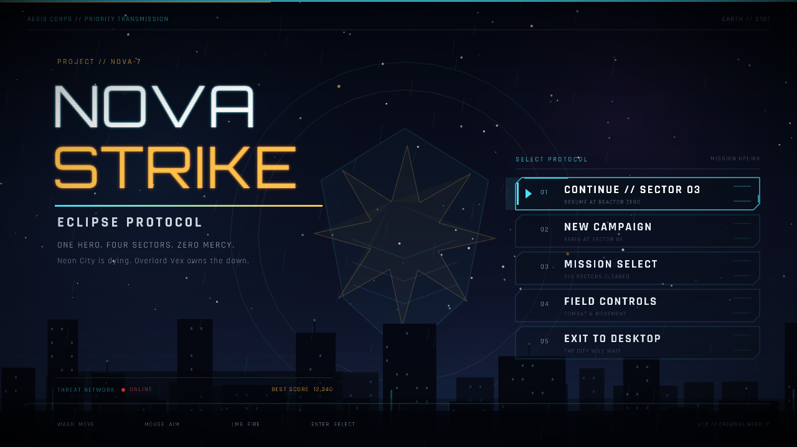
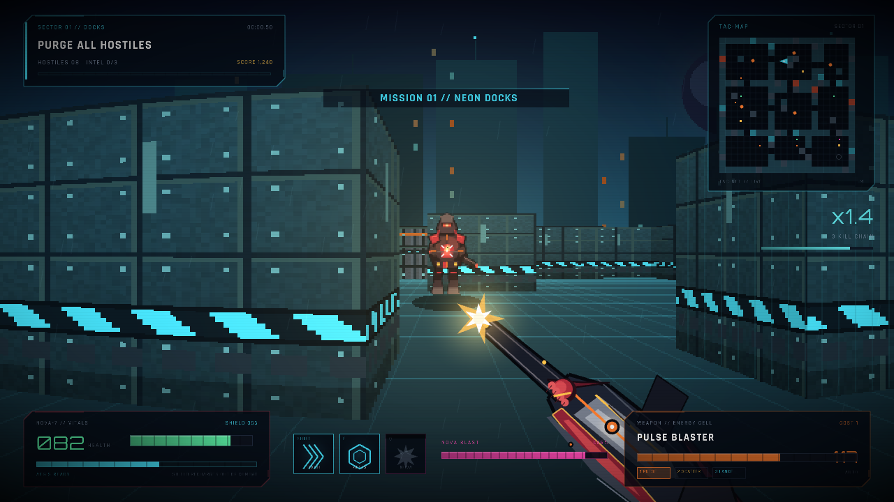
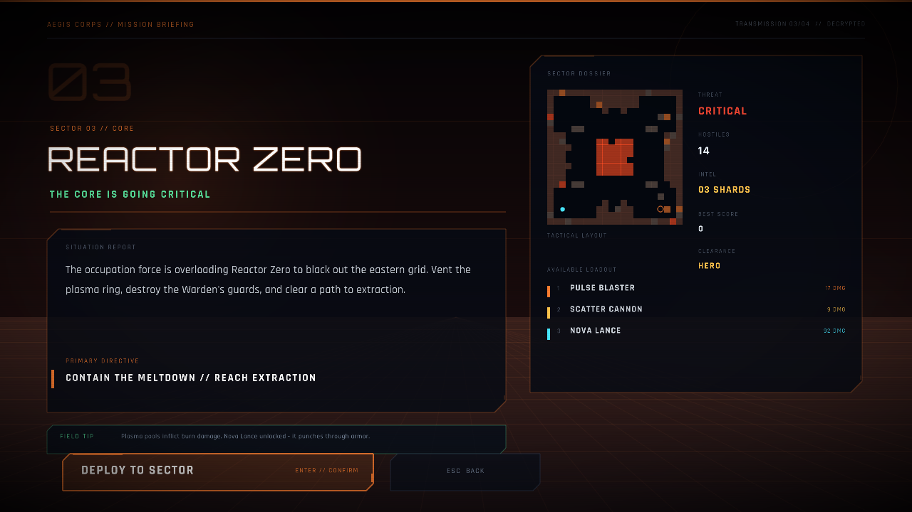
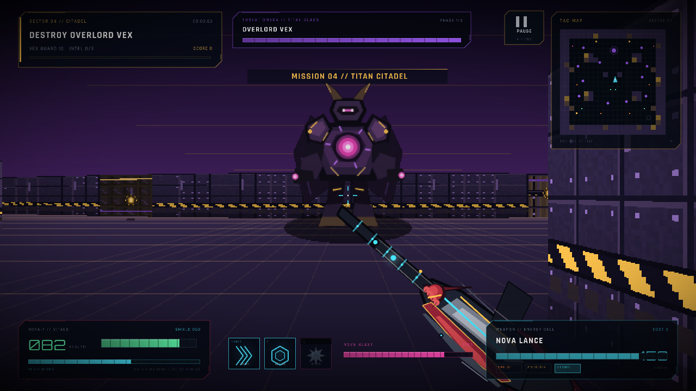

# NOVA STRIKE: ECLIPSE PROTOCOL

A complete, original superhero DOOM-style first-person shooter built in **Python with raylib**.
Neon City has fallen under the shadow of Overlord Vex. You are **NOVA-7**, the last Aegis hero.
Fight through four hand-built sectors, build kill chains, collect intel, master three weapons and
three superpowers, then break Vex's Titan Citadel.



## Play it

Requires **Python 3.10+** (Python 3.14 is fine) and a desktop GPU/display. The launcher creates a
local virtual environment and installs the only dependency, `raylib`.

### macOS / Linux

```bash
cd raylib_game
./run.sh
```

On macOS you can also double-click **run.command**.

### Windows

Double-click **run.bat**, or from PowerShell:

```bat
cd raylib_game
python -m venv .venv
.venv\Scripts\python -m pip install -r requirements.txt
.venv\Scripts\python main.py
```

### Manual

```bash
python3 -m venv .venv
.venv/bin/python -m pip install -r requirements.txt
.venv/bin/python main.py
```

The audio cache is included, so the game starts immediately. If `assets/audio/` is missing,
the first launch regenerates the sound effects and two synthwave music loops with the Python
standard library (about 2 MB). No network or external game assets are needed beyond the bundled
open-source fonts.

## Features

- **4 complete missions** with unique floorplans, palettes, hazards and a final boss.
- **DOOM-style raycasting FPS** rendered at 640x360 and upscaled for a crisp retro look.
- **Full level flow**: title screen, mission select, briefings, pause, mission stats, game over,
  unlocks, save file and an ending screen.
- **3 weapons**: Pulse Blaster, Scatter Cannon and Nova Lance. New weapons unlock as sectors clear.
- **3 superhero powers**: dash, AEGIS shield and a charged NOVA BLAST.
- **4 enemy classes**, including Vex Troopers, Wraith Drones, Juggernauts and Overlord Vex.
  The boss has three phases and summons guard waves.
- **Combat systems**: shields that recharge out of combat, energy ammo, combo multipliers,
  hit markers, damage direction indicators, pickups, intel shards, hazard damage and rank scoring.
- **Procedural presentation**: hand-drawn-in-code sprites, wall textures, rain/embers, scanlines,
  UI, and synthesized sound effects and music. No external art assets are used; only the bundled
  fonts and generated audio files are loaded.
- **Persistent progression** in `savegame.json`: unlocked sectors, best scores, ranks and career stats.



## Controls

| Input | Action |
| --- | --- |
| **W A S D** | Move |
| **Mouse** | Look |
| **Left Mouse** | Fire |
| **Right Mouse** | Aim down sights (tighter spread, slower movement) |
| **Shift** | Hero dash (brief invulnerability) |
| **E** | AEGIS shield (10 second cooldown) |
| **Q** | NOVA BLAST when the charge meter is full |
| **1 / 2 / 3** or **Mouse Wheel** | Switch weapons |
| **M** | Mute / unmute |
| **F12** | Save a screenshot to `screenshots/` |
| **Esc** | Pause (or back out of menus) |

## Missions

1. **Neon Docks** - learn the hero kit in the flooded container yards.
2. **Skybridge Nine** - a wide-open rooftop blockade introduces Juggernauts.
3. **Reactor Zero** - plasma pools, a burning core, and the Nova Lance.
4. **Titan Citadel** - Overlord Vex, a three-phase boss and the Eclipse Protocol.

Clear all hostiles to bring the extraction beacon online, then step onto the pad.
Collect the three gold **intel shards** in each sector for a large score bonus.
Securing a sector unlocks the next one and raises your rank on the mission-select screen.

### Combat tips

- Your shield absorbs damage first, then regenerates after three seconds without being hit.
- Dash through projectile volleys; the dash grants a brief invulnerability window.
- The Scatter Cannon has heavy damage falloff. Get close.
- The Nova Lance pierces up to four targets and is ideal against Vex's armour.
- NOVA BLAST clears rooms and destroys nearby enemy projectiles. Build charge with hits and kills.
- Keep cover between you and Juggernaut shotgun bursts.

## Screens

| Mission briefing | Boss encounter |
| --- | --- |
|  |  |

## Project layout

```
raylib_game/
  main.py                 entry point
  run.sh / run.command    macOS/Linux launchers
  run.bat                 Windows launcher
  requirements.txt
  game/
    audio.py              synthesized SFX, music loops and playback
    config.py             screen constants, palette and helpers
    entities.py           weapons, player, enemies and effects
    fonts.py              bundled font loading and text helpers
    game.py               states, combat, AI, progression and main loop
    levels.py             four floorplans and themes
    raycompat.py          raylib CFFI drawing compatibility wrappers
    textures.py           procedural wall/enemy/pickup textures
    ui.py                 menus, HUD, weapon viewmodel and overlays
    world.py              raycasting renderer, collision and navigation
  assets/
    fonts/                Orbitron + Rajdhani (SIL OFL, licenses included)
    audio/                generated WAV cache
  screenshots/
```

## Technical notes

- Raycasting renders 320 columns into a 640x360 render target at 60 FPS, then upscales to 1280x720
  with point filtering. HUD and menu typography render at native resolution.
- Wall textures are generated pixel-by-pixel at load. Enemy sprites are vector-drawn into render
  targets, flipped/downsampled in Python, and depth-tested per column against the raycast z-buffer.
- Enemy navigation uses a breadth-first flow field recomputed around the player.
- Sound effects and the two music loops are synthesized with the standard library `wave` module.
- Save data uses an atomic JSON write and is safe to delete to reset progress.

## Credits

Game design, code and procedural art: original project for this repository.

Fonts: **Orbitron** and **Rajdhani** from Google Fonts, licensed under the SIL Open Font License.
The license texts are in `assets/fonts/OFL-Orbitron.txt` and `assets/fonts/OFL-Rajdhani.txt`.

Built with [raylib](https://www.raylib.com/) and
[raylib-python-cffi](https://github.com/electronstudio/raylib-python-cffi).
