# THORNSPIRE

**A procedural climbing platformer built with pygame, moderngl and numpy.**

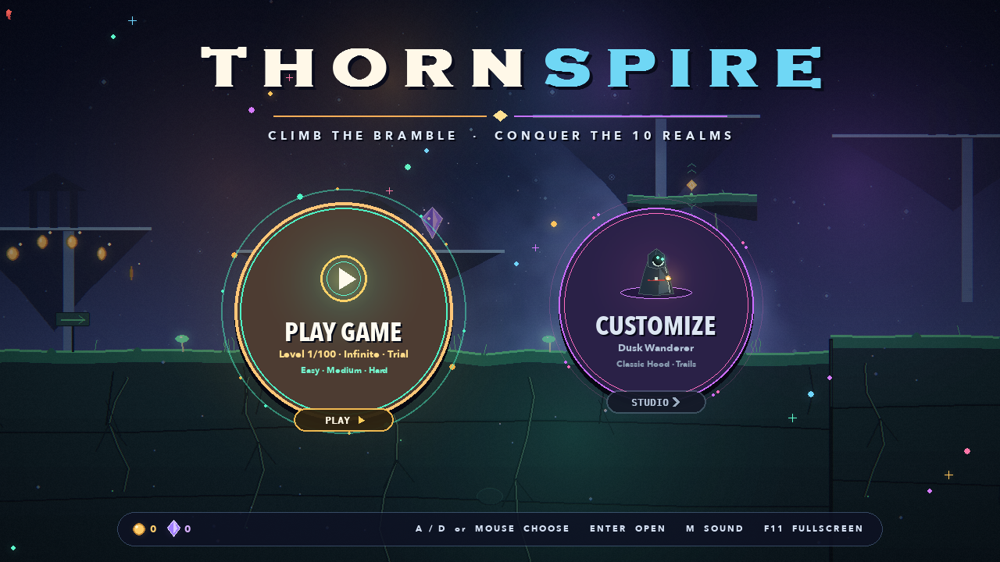

THORNSPIRE is an endless, side-scrolling climb through a haunted bramble. Leap
between root platforms, scale glowing vines, dash under a spitter's thorn, and
hoard coins and gems while the world quietly rearranges ahead of you. There is
no final level — the biomes wheel around forever.

The entire game is asset-free: the terrain, creatures, UI, sky and soundtrack
are generated in code.

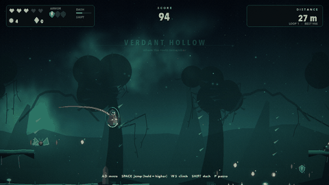

---

## Features

- **100 Levels Quest & Rift Gateways** — A full 100-level campaign with paginated level selection, star ratings (1 to 3 stars), and dimensional Rift Gateways at the goal.
- **Difficulty Modes (Easy, Medium, Hard)** — Tune the experience with tailored starting hearts (5 / 3 / 2), shield charges (2 / 1 / 0), and enemy projectile/movement speed scaling.
- **Hero Customization & Animated Preview** — Customize your runner with 8 cloak styles, 7 scarf colors, 6 headgears (Pointed Hood, Golden Crown, Bramble Horns, Ninja Bandana, Radiant Halo, Wizard Hat), and 5 particle trails (Flame, Stars, Ghost Afterimages, Prismatic Sparkles).
- **10 Unique Procedural Worlds** — Explore distinct architecture and weather across Ember Reach (volcanoes & lava), Frost Weald (glaciers & snowfall), Void Bloom (floating monoliths), Sunken Abyss (temple ruins & rising bubbles), Solar Dunes (pyramids & sandstorms), Celestial Spire, Toxic Mire, Crimson Citadel (gothic keeps & blood moon), Aether Heights (sky-islands & waterfalls), and Verdant Hollow.
- **Expanded 9-Enemy Bestiary** — Crawlers, Gloomwings, Spitters, plus 6 specialized level adversaries:
  - **Crusher**: Suspended runic guillotine monolith that locks on, trembles crimson, and slams downward.
  - **Bomber**: Aerial cinder-wyrm sweeping overhead and dropping arcing gravity firebombs.
  - **Jumper**: Spring-legged mantis that charges leaps toward the hero.
  - **Shocker**: Floating volt sentinel with rotating lightning prongs and electrostatic pulse fields.
  - **Ghost**: Phase-shifting phantom drifting between intangible and dangerous forms.
  - **Roller**: Fast-spinning spiked wheel bouncing along platforms and walls.
- **Dedicated All-Lives-Lost Stats Screen** — On death, highlights your run's **Coins**, **Gems**, and **Time Taken** in prominent telemetry cards.
- **Vertical Traversal** — Vine climbing, wall slides, wall jumps, one-way ledges, drop-through, and dynamic elevator platforms.
- **Hold-to-Jump** — Tap Space for a short hop, or hold for higher leaps with vertical boost trails.
- **Dynamic Floating-Circle Menu Hub** — Boot directly into a colorful aurora-lit Title Screen with two animated floating circles (**PLAY GAME** and **CUSTOMIZE**), pick your mode (**100 Levels**, **Infinite Run**, or **Time Trial**), and choose your difficulty (**Easy**, **Medium**, or **Hard**) to launch immediately.
- **Shader Pipeline** — Offscreen OpenGL post-processing: dynamic sky, soft bloom, chromatic aberration, film grain, and damage warp.
- **100% Asset-Free Generation** — Terrain, monsters, shaders, vector UI icons/arrows, hero gear, and NumPy audio synthesis all generated purely in code.

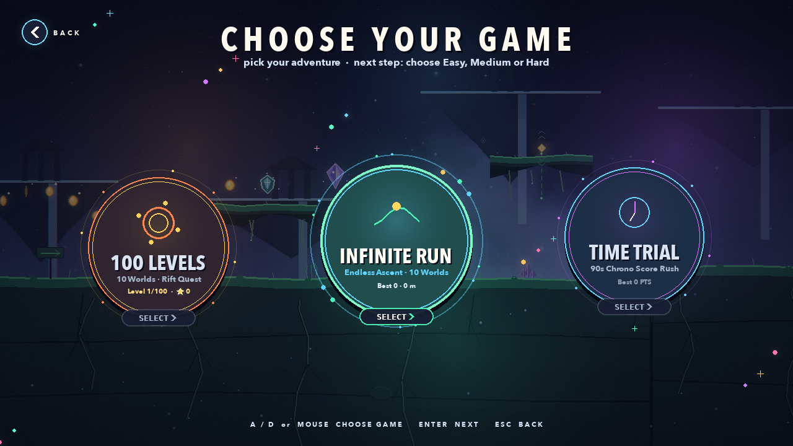
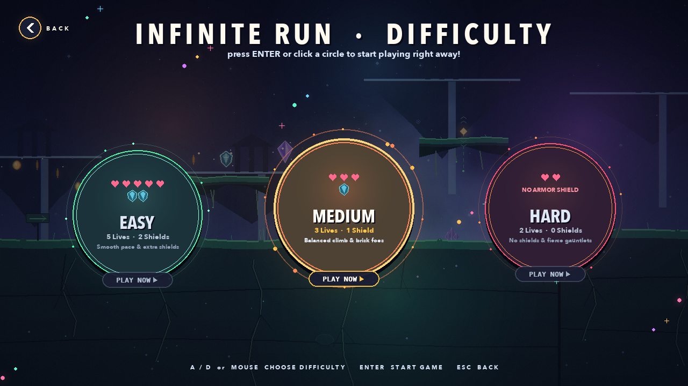
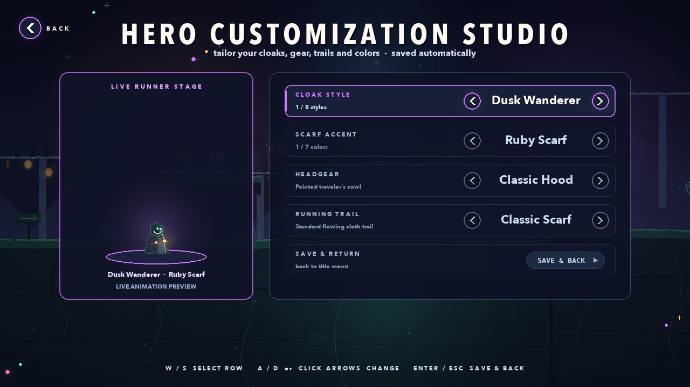
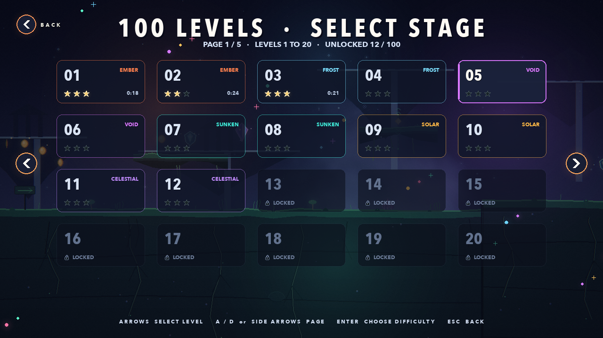

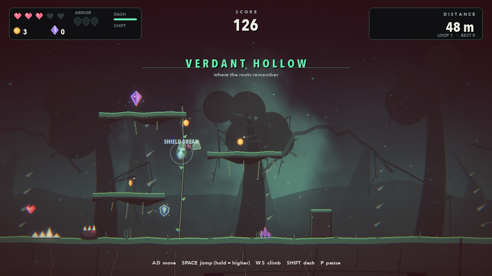

---

## Quick start

Requires **Python 3.10+** (tested on Python 3.14.6 / macOS 26 / Apple M4).

### macOS

Double-click `run.command`, or from a terminal:

```bash
cd platformer_game
./run.sh
```

The launcher creates `.venv` and installs dependencies on first run.

### Manual

```bash
cd platformer_game
python3 -m venv .venv
source .venv/bin/activate          # Windows: .venv\Scripts\activate
pip install -r requirements.txt
python main.py
```

### Windows

Double-click `run.bat`, or run the manual commands above.

> `Pillow` is only used by the screenshot/GIF capture tool; the game itself
> needs pygame-ce, moderngl and numpy.

---

## Controls

| Action | Keys |
| --- | --- |
| Move | `A` / `D` or `←` / `→` |
| Jump — tap for a short hop, hold for height | `Space` |
| Climb up / down vines | `W` / `S` or `↑` / `↓` |
| Jump off a vine | `Space` |
| Dash | `Shift` or `X` |
| Drop through a one-way ledge | `↓` + `Space` |
| Pause | `P` / `Esc` |
| Mute / unmute | `M` |
| Fullscreen | `F11` |
| Screenshot | `F12` |
| Show FPS / render time | `F3` |

The dash recharges in 0.85 s and can be used once per airtime. Vines are
grabbed by holding up or down while overlapping them. Stone blocks and tall
ground edges allow wall slides and wall jumps. Elevator platforms carry you
while you stand on them.

---

## Modes and scoring

### Endless Loop

No timer. The world goes on forever and loops through the four biomes. You have
three hearts (up to five) and one shield. A shield absorbs a hit before a heart
does; shield shards found in the world add up to three. When hearts run out the
run ends. Checkpoints heal one heart and set your respawn point. A fall into a
pit costs a heart and returns you to the last checkpoint, so the dark is never
instant death — until it is.

### Time Trial

90 seconds to score as much as possible. Chrono shards add **+5 s**. Running
out of hearts does not end the run immediately: it costs **−15 s** and returns
you with two hearts. Falling into a pit costs **−8 s**. When the clock
hits zero the run ends and your banked score is final.

### Points

| Source | Value |
| --- | --- |
| Coin | 10 |
| Gem | 100 |
| Heart | 25 |
| Shield shard | 60 |
| Chrono shard | 40 |
| Distance | 2 per metre |
| Completed loop | +500 |
| Checkpoint | +50 |

Coins, gems, hearts and shield shards are multiplied by the current combo
multiplier (up to ×5). The combo timer is 3.6 s and resets on damage. Collecting
a pickup refreshes it.

### Armor and dynamic terrain

Shield charges live beside the hearts in the HUD. They absorb contact damage
from thorns, creatures and projectiles; a shield break is loud, bright and
costs no health. Each run starts with one charge and shield shards can take you
to three.

Some ledges are **elevators**: their height oscillates continuously, their
motion path is marked by a rune and a dotted guide, and they carry the player
up or down while standing on them.

---

## Screenshots

| | |
| --- | --- |
| 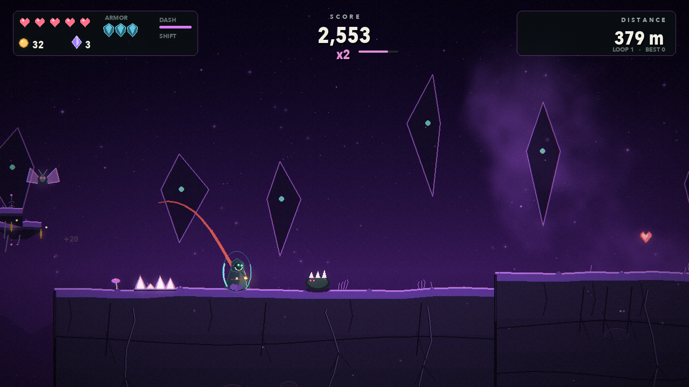 | 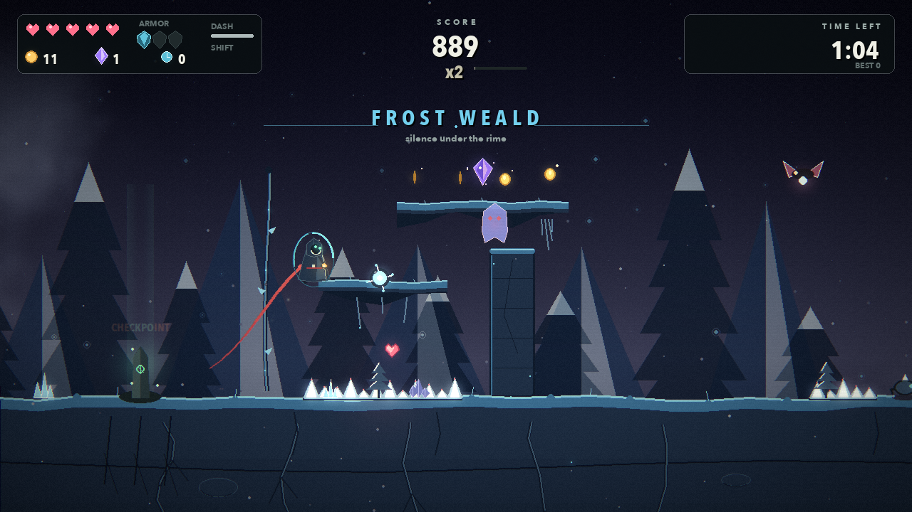 |
| 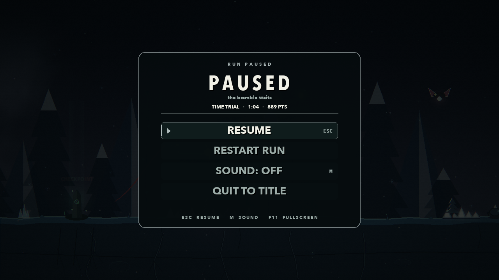 | 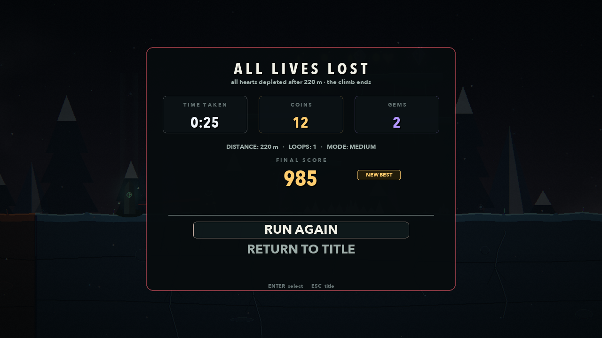 |

---

## Project layout

```
platformer_game/
├── main.py                 entry point + CLI flags
├── requirements.txt
├── run.command / run.sh / run.bat
├── save.json               created at runtime (best scores, totals, mute)
├── game/
│   ├── game.py             states, run loop, scoring, camera, effects
│   ├── level.py            chunk generation, features, collision world, terrain art
│   ├── player.py           movement, climbing, dash, hold-jump, armor, art
│   ├── enemies.py          crawler / flyer / spitter + projectiles
│   ├── pickups.py          coins, gems, hearts, shields, chrono shards, checkpoints
│   ├── particles.py        particles, floating score text, ambient motes
│   ├── background.py       procedural parallax silhouettes per biome
│   ├── renderer.py         moderngl pipeline + software fallback
│   ├── shaders.py          GLSL: sky, bright pass, blur, final grade
│   ├── ui.py               HUD, title, pause, results
│   ├── audio.py            numpy synthesis for SFX and music
│   ├── bot.py              reactive autopilot for demos/captures
│   ├── constants.py        tuning, palettes, fonts
│   └── utils.py            maths, colour, glow sprites, text helpers
├── tools/
│   └── capture.py          regenerates screenshots/ and preview.gif
└── screenshots/
```

---

## How the rendering works

```
pygame world surface (RGBA, transparent background)
        │  upload (flipped to match GL row order)
        ▼
moderngl pass 1 ── composite over procedural sky (aurora, stars, haze)
        │
        ├─ pass 2 ── bright pass       (320×180)
        ├─ pass 3 ── blur horizontal   (320×180)
        ├─ pass 4 ── blur vertical     (320×180)
        │
        ▼
moderngl pass 5 ── bloom + chromatic aberration + vignette + grain + damage
        │             (geometry is flipped here to cancel readback orientation)
        ▼
glReadPixels → pygame.Surface → blit to window → UI drawn on top
```

The world, sprites and terrain are drawn with pygame onto a transparent
surface. The sky, glow and grading happen on the GPU. UI stays crisp because it
is drawn after the readback.

### Notes for tinkerers

- The renderer creates CPU-written textures **with initial data** and then calls
  `write()` on them. On Apple's GL stack, a texture created empty and filled
  later can be treated as an unloadable float sampler (black screen). The seeded
  texture avoids that driver quirk.
- The final pass flips the fullscreen quad on Y. Framebuffer readback is
  bottom-up, and pygame surfaces are top-down; flipping in the vertex shader is
  free and keeps the world/sky aligned.
- The world texture uses straight alpha and is composited with `mix(sky,
  world.rgb, world.a)`.
- Everything is 1280×720 at a target of 60 fps. The GL round trip is around
  6 ms on an M4, leaving room for simulation and drawing.

### Procedural generation in one paragraph

Each chunk picks a feature from a weighted table. Features carve gaps, add
ground and floating ledges, thorns, vines, coin arcs, gems and enemies. Ground
height drifts by at most 40 px between chunks so routes stay jumpable. Biomes
change every nine chunks and the four-biome wheel repeats; difficulty rises
until roughly chunk 55. Vines plus wall jumps make the vertical routes; enemies
are placed to guard the reward. Seeds are deterministic, so `--seed` reproduces
a world exactly.

### Audio

All sounds are numpy arrays turned into `pygame.mixer.Sound` objects at startup.
The music is a 13.3-second ambient loop at 72 BPM (four chords, pad, bass,
arpeggio, wind, wrapped reverb). If the mixer cannot initialize, the game simply
runs silently.

---

## Command-line flags

```bash
python main.py                          # launch game (100 Levels Quest default)
python main.py --mode levels --level 10 # jump directly to level 10
python main.py --difficulty hard        # set Easy / Medium / Hard mode
python main.py --mode trial             # boot into 90s Time Trial
python main.py --seed 1234              # reproducible world
python main.py --autoplay --god         # attract-mode bot demo
python main.py --headless --autoplay --god --max-seconds 5
python main.py --mute
python main.py --fullscreen
```

- `--headless` uses SDL's dummy video/audio drivers (useful on CI).
- `--god` disables damage/fall damage (debugging and captures).
- `--max-seconds` quits automatically; handy for smoke tests.

### Regenerating the media

```bash
.venv/bin/python tools/capture.py
```

The tool runs headless, writes `screenshots/title.png`,
`gameplay_climb.png`, `gameplay_loop.png`, `gameplay_trial.png`, `pause.png`,
`gameover.png` and `preview.gif`, then resets `save.json`.

---

## Tuning

Most feel lives in `game/constants.py`:

- `GRAVITY`, `JUMP_VELOCITY`, `MOVE_SPEED`, `DASH_SPEED`, `CLIMB_SPEED`
- Hold-jump: `JUMP_HOLD_TIME`, `JUMP_HOLD_GRAVITY`, `JUMP_CUT_SPEED`
- `CHUNK_W`, `CHUNKS_PER_BIOME`, `TRIAL_TIME`
- `START_ARMOR`, `MAX_ARMOR`, `ARMOR_INVULN`
- `BIOMES` — every colour used by both pygame and the sky shader
- `MAX_HEARTS`, combo values, point values

Elevator platform height, amplitude and speed are the arguments to
`_add_moving_ledge(...)` in `game/level.py`; chunk ground heights live in
`World._make_chunk`.

Feature weights and layouts are in `World._make_chunk` and the `_f_*` methods in
`game/level.py`; enemies live in `game/enemies.py`; post-processing is in
`game/shaders.py`.

---

## Troubleshooting

**`ModuleNotFoundError: No module named 'pygame'`** — run `./run.sh` (it creates
the venv) or activate `.venv` before `python main.py`.

**Black screen or no window** — run from a terminal and look at stderr. If the
GPU context fails, the game prints a message and uses the software renderer. On
macOS, moderngl uses the OpenGL 4.1 driver over Metal; a recent OS is required.

**No sound** — check the system output device and that the mixer initialized.
The game is fully playable muted (`M`).

**Fullscreen glitches** — F11 uses `FULLSCREEN | SCALED`; on some macOS setups
the native green-button fullscreen behaves better. The toggle is guarded so a
failure returns to the window.

**Reset progress** — delete `save.json`; it is recreated on the next run.

---

## Built with

- [pygame-ce](https://pyga.me/) 2.5.8 — window, input, world rendering, UI
- [moderngl](https://moderngl.readthedocs.io/) 5.13 — offscreen shader pipeline
- [numpy](https://numpy.org/) 2.5 — generation, glow gradients, particles, audio
- [Pillow](https://python-pillow.org/) — only for the capture tool

No external art, fonts bundled, or audio files are used. The display fonts are
system fonts with cross-platform fallbacks (Copperplate on macOS, Georgia on
others).

---

*Climb the bramble. Outrun the dark.*
